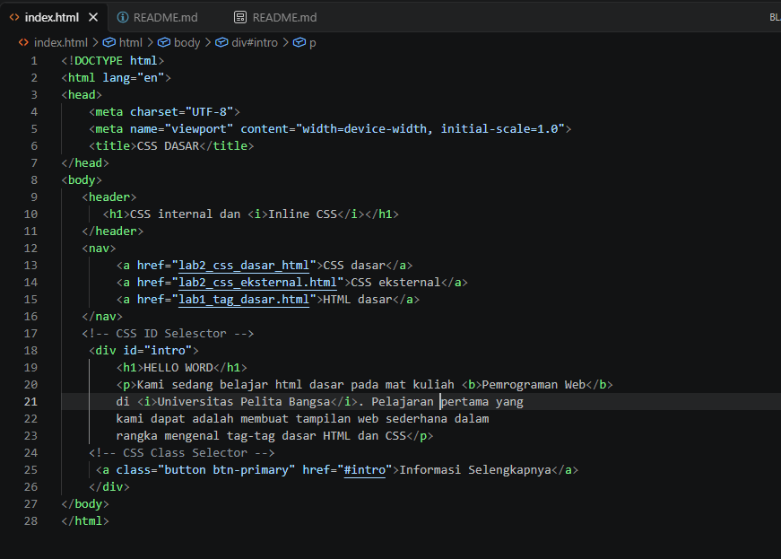
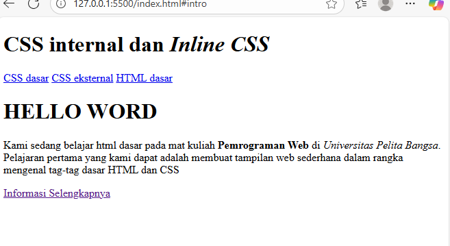
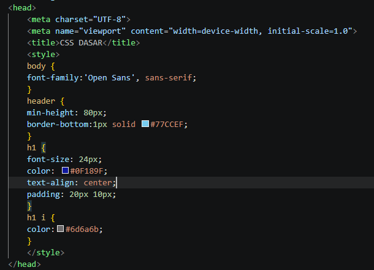
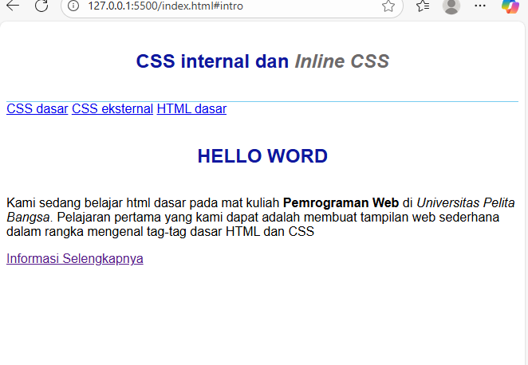
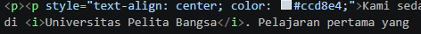
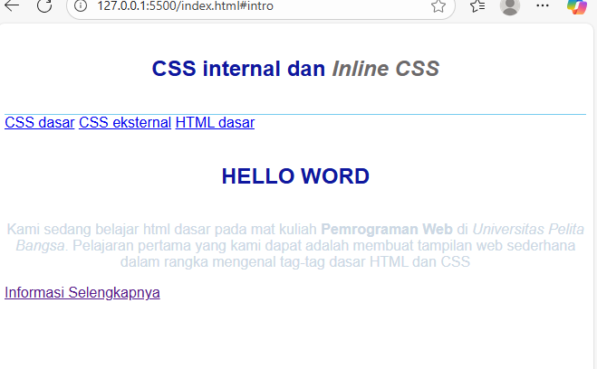
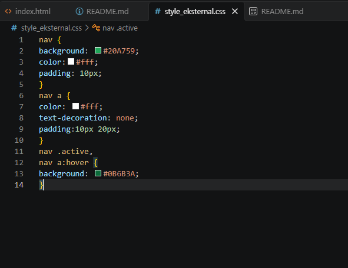
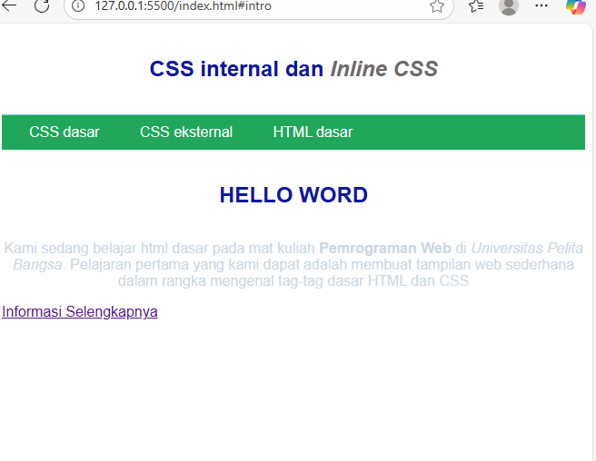
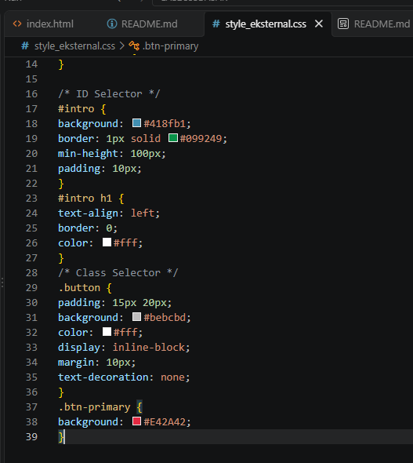
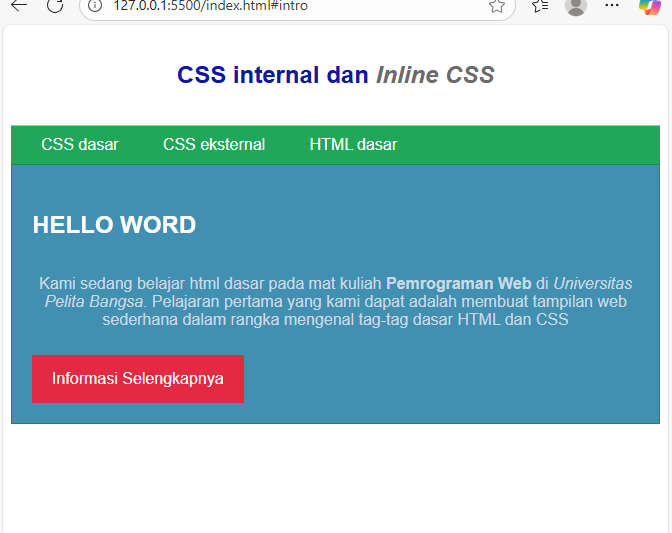

## PRAKTIKUM 3

Tugas praktikum ini bertujuan untuk memberikan pemahaman terkait dengan cara menambahkan css ke html.

1. <b>Gambar tampilan HTML</b>

<i>diatas merupakan tampilan html yang belum ditambahkan css ke dalamnya.</i>

2. <b>Tampilan CSS Internal</b>.

<i>Diatas merupakan tampilan html yang sudah dibunkus dengan css pada bagian internalnya</i>

3. <b>Deklarasi Inline pada tag p</b>

4. <b>CSS eksternal pada gambar dibawah</b>

<i>Diatas merupakan css eksternal yang sudah dibunkus menggunakan css, dengan file terpisah dan dipanggil menggunakan link reel pada file tersebut</i>

5. <b>Tampilan CSS Selector</b>

Css selector yang sudah ditambahkan kedalam file style_eksternal.css

